<div align="center">

# TriageBot

**Evidence-grounded, multi-agent triage of static-analysis security alerts.**

SE201 AI-Driven Software Engineering · Team G1T4

[](https://github.com/than-wl/SE201-G1T4-TriageBot/actions/workflows/tests.yml) [](#3-quick-start) [](data/semgrep/) [](triagebot/council_graph.py) [](#6-how-it-works) [](#2-results)

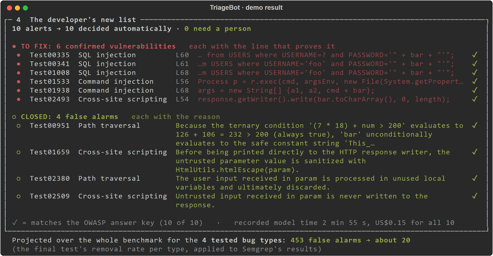

<sub>Ten alerts from the final test, shown by the demo (menu option 5). The full results, mistakes included, are in <a href="#2-results">Results</a>.</sub>

</div>

---

## Table of contents

1. [What TriageBot is](#1-what-triagebot-is)
2. [Results](#2-results)
3. [Quick start](#3-quick-start)
4. [Runnable examples](#4-runnable-examples)
   - [The demo and the full PDF report](#the-demo-and-the-full-pdf-report)
5. [Where things are](#5-where-things-are)
6. [How it works](#6-how-it-works)
7. [Troubleshooting](#7-troubleshooting)
8. [Responsible AI and safety](#8-responsible-ai-and-safety)
9. [Team and roles](#9-team-and-roles)
10. [Third-party content](#10-third-party-content)

---

## 1. What TriageBot is

A static-analysis scanner such as Semgrep flags code that *might* be
vulnerable, and many of its alerts are false alarms that a developer must still
read. TriageBot is a second stage after the scanner: for each alert it gathers
the code and security guidance that decide the answer, and an AI council
sorts the alert into **likely a real vulnerability**, **likely a false alarm**
or **needs a human**. Every verdict must quote the source it relies on, and
deterministic code checks those quotes. TriageBot never adds alerts, so the
scanner's recall is its ceiling.

<p align="center">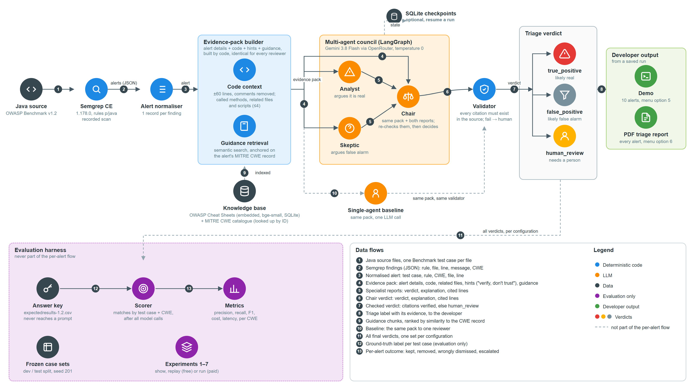<br>
<sub>Architecture: scanner → evidence pack → council → validator → verdict, with the evaluation harness kept apart.</sub></p>

The image is drawn from [docs/architecture/architecture.html](docs/architecture/architecture.html)
(open it in a browser to edit or re-export). A simpler Mermaid version is in
[docs/architecture/README.md](docs/architecture/README.md).

---

## 2. Results

All current results are in **[EXPERIMENTS.md](EXPERIMENTS.md)**, the single
source of truth: what each experiment asked, what changed, and every number.
They were measured on the OWASP Benchmark (Java) for four weakness types: path
traversal (CWE-22), OS command injection (CWE-78), cross-site scripting (CWE-79)
and SQL injection (CWE-89). Gemini 3.8 Flash, temperature 0.

**Council vs single agent on 120 unseen cases** (step 7, runs `6-before` and
`6-after`, run once after the code freeze):

| | Single agent | Council (validated) |
| --- | ---: | ---: |
| Precision / recall / F1 | 94.3% / 83.3% / 88.5% | 95.2% / 98.3% / **96.7%** |
| Real vulnerabilities dismissed (of 60) | 10 | **1** |
| False alarms removed (of 60) | 57 | 57 |
| Sent to a human (of 120) | 2 | 1 |
| Cost (US$) / mean latency (s) | 0.53 / 9.9 | 1.76 / 18.8 |

<p align="center">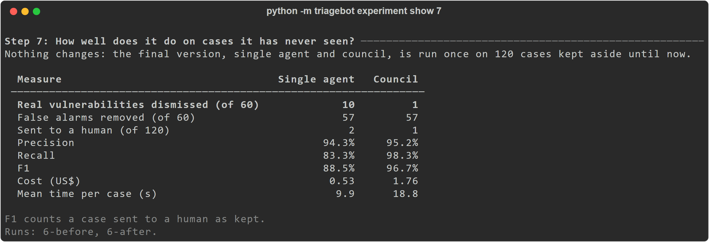<br>
<sub>The same table from the saved runs: <code>python -m triagebot experiment show 7</code>.</sub></p>

**Whole system vs Semgrep alone** (a projection of step 7 over the whole
benchmark for the four types; `evidence/whole_system/6-after.md`): precision
59.6% → **97.1%**, recall 86.0% → 85.0%, false alarms left 453 → about 20. Of
the about 117 real vulnerabilities still missed, 109 are ones Semgrep never
flagged: Semgrep is now the bottleneck.

**Does the verdict follow the code?** (step 6, runs `5-before` and `5-after`):
in 22 pairs, one character was changed so that the right answer flipped while
Semgrep's alert stayed the same. Mutation score: council **100%** (22 of 22),
single agent 53% (8 of the 15 it got right to begin with).

**Semantic retrieval** (step 5, run `4-after`): guidance found by search,
anchored on each weakness's MITRE record, held accuracy within the noise floor
(F1 95.0% vs 96.0%) and needs no hand-written weakness-to-guidance table.

**Semgrep alone, all categories** (a different scope: all 2,740 Benchmark cases
across all 11 categories, `p/java`, CWE-matched): precision 65.5%, recall
68.6%, F1 67.0%. Menu option 1 shows it.

<p align="center">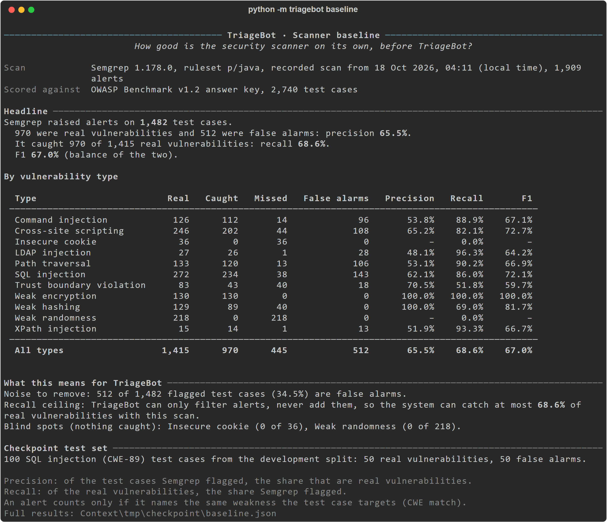<br>
<sub>Menu option 1: Semgrep alone over the whole benchmark.</sub></p>

Earlier runs (the checkpoint, the first and second 120-case evaluations, the
66-case comparison) are superseded and kept in [archive/](archive/README.md).

---

## 3. Quick start

Tested with Python 3.12.7 on Windows 11. Run every command from the repository
root.

**1. Python and a virtual environment.** Python 3.10 or newer, and
[Git](https://git-scm.com/downloads).

```bash
git clone https://github.com/than-wl/SE201-G1T4-TriageBot.git
cd SE201-G1T4-TriageBot
```

| Windows (PowerShell) | macOS / Linux |
| --- | --- |
| `py -m venv .venv` | `python3 -m venv .venv` |
| `.\.venv\Scripts\Activate.ps1` | `source .venv/bin/activate` |
| `python -m pip install -r requirements.txt` | `python -m pip install -r requirements.txt` |

Activate the environment again in every new terminal. From here on, `python`
means the venv's Python.

**2. The API key (only for paid runs).** Copy `.env.example` to `.env` and set
your own `OPENROUTER_API_KEY` there. Never commit `.env`; it is git-ignored.
Every free command below works without it.

**3. The OWASP Benchmark** (about 100 MB, at the pinned commit, in
`Context/tmp/BenchmarkJava`):

```bash
git clone https://github.com/OWASP-Benchmark/BenchmarkJava.git Context/tmp/BenchmarkJava
```

```bash
git -C Context/tmp/BenchmarkJava checkout 8b67a88d73b2594570fc21150705283de884620b
```

The menu's setup check also offers to clone it for you.

**4. Prepare the guidance retrieval (once; free and local, no model calls):**

```bash
python -m triagebot.nodes.context.cwe_catalogue
```

```bash
python -m triagebot.nodes.context.vector_store
```

The first downloads the MITRE CWE catalogue (SHA-256 checked). The second
downloads the embedding model and builds the local vector store: **the first
build takes several minutes and prints nothing until it finishes.** Both write
only to the git-ignored `Context/tmp/`.

**5. Open the menu:**

```bash
python -m triagebot
```

<p align="center">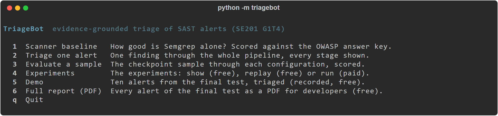</p>

| Option | What it does |
| --- | --- |
| 1 Scanner baseline | Semgrep alone over the whole benchmark (free) |
| 2 Triage one alert | One case through the single agent or the council (paid) |
| 3 Evaluate a sample | The checkpoint sample through each configuration, scored (paid; asks first) |
| 4 Experiments | Every step of EXPERIMENTS.md: show, replay (free) or run (paid; asks first) |
| 5 Demo | Ten alerts from the final test, triaged (recorded, free) |
| 6 Full report (PDF) | Every alert of the final test as a PDF for developers (free) |

**6. Check the set-up** (Python, venv, Benchmark and its commit, the scan, the
case sets), with the fix for anything missing:

```bash
python -m triagebot check
```

<p align="center">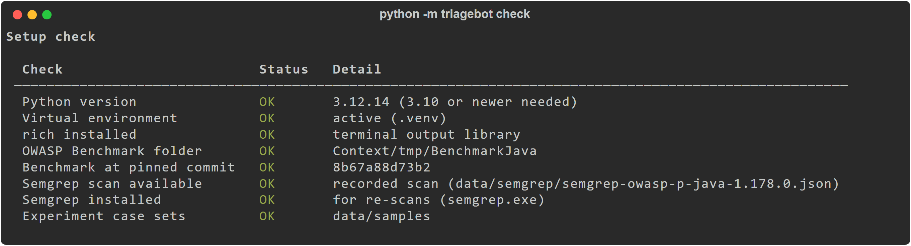</p>

---

## 4. Runnable examples

**Free** (no model calls, no API key):

```bash
python -m triagebot experiment list
```

```bash
python -m triagebot experiment show 7
```

```bash
python -m triagebot experiment replay 5
```

```bash
python -m triagebot.nodes.context.retrieval --explain CWE-22 --setup improved
```

```bash
python -m triagebot.nodes.context.retrieval --explain CWE-22 --setup original
```

```bash
python verification/whole_system.py --mode council
```

```bash
python verification/semantic_setup_check.py --phase score
```

```bash
python -m triagebot baseline
```

- `experiment show <step>` prints a step's before/after table from the saved
  results and needs nothing else. `experiment replay <step>` re-scores the
  saved verdicts against the Benchmark answer key and checks they equal the
  committed report. Steps 1 to 7, in story order (`experiment list`); run
  folders keep their internal IDs ([Step numbers](EXPERIMENTS.md#step-numbers)).
  `experiment show 7 --by-cwe` adds the table per weakness.
- `--explain` shows the guidance one weakness gets: `improved` is the final
  set-up, `original` the first one (all five set-up rules off). It needs step
  4 of the quick start.
- `whole_system.py` (`--mode council` or `single`) and `semantic_setup_check.py
  --phase score` recompute their reports from committed data and rewrite them
  under `evidence/`; only the date and commit lines change.
- `baseline` is menu option 1.

<p align="center">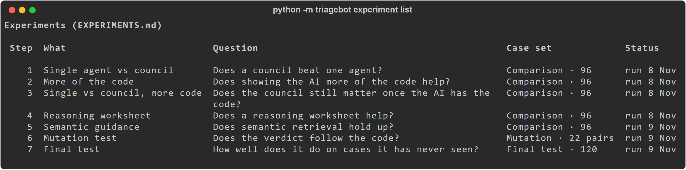<br>
<sub>The seven experiment steps, in story order.</sub></p>

**Paid** (OpenRouter calls; needs the API key):

```bash
python -m triagebot experiment run 5
```

Before any call it prints the case set, the number of calls and the estimated
cost, and asks for confirmation. It saves each case as it finishes, so an
interrupted run resumes. Step 7 is the final test and is guarded: it refuses
uncommitted changes and refuses a second run.

All subcommands: `python -m triagebot --help`.

### The demo and the full PDF report

Both replay the saved final-test run (`evidence/experiments/6-after`): free,
no model calls.

```bash
python -m triagebot demo --step
```

```bash
python -m triagebot report
```

- `demo` (menu option 5) walks through ten alerts from the final test: the
  scanner, the alerts, the council's decisions and the developer's new list
  (the image at the top of this page). `--step` waits for Enter between scenes.
  At the end, the menu offers to download the full report.
- `report` (menu option 6) writes every alert of the run to
  `Context/tmp/reports/triagebot-report-6-after.pdf`, grouped as **to fix**,
  **closed** and **for a person**. Each finding shows a summary, the cited lines
  labelled by role, the council's votes, the citation check and, for real
  vulnerabilities, MITRE's recommended fix. It never reads the answer key.
  `--run` picks another saved run, `--out` another path.

<table>
<tr>
<td width="50%">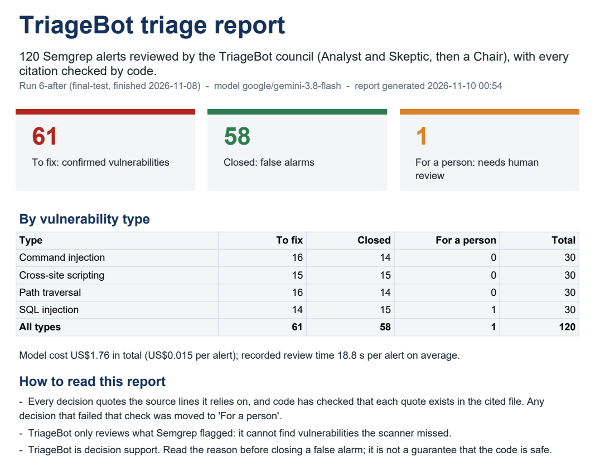</td>
<td width="50%">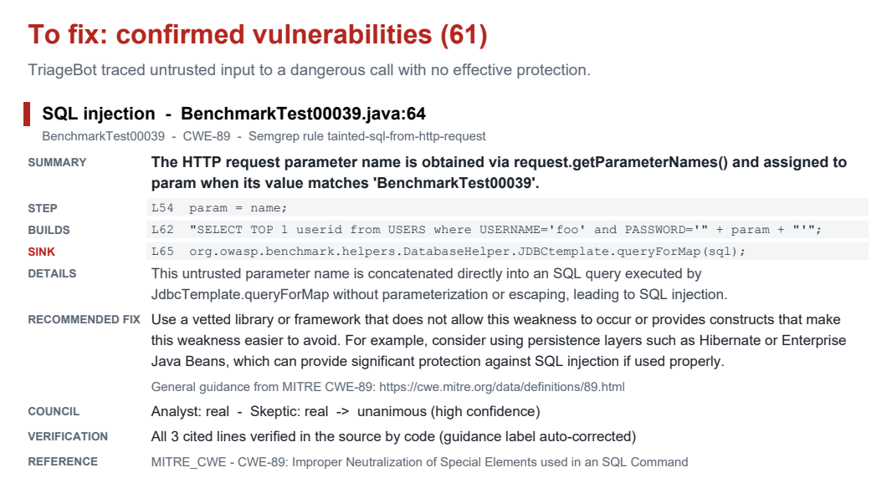</td>
</tr>
<tr>
<td>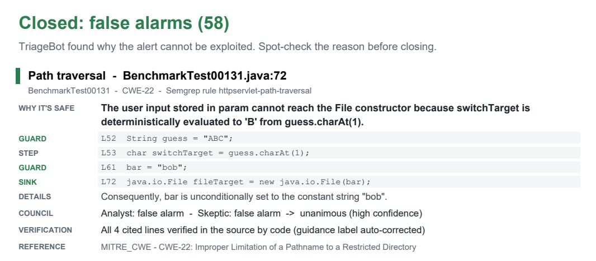</td>
<td>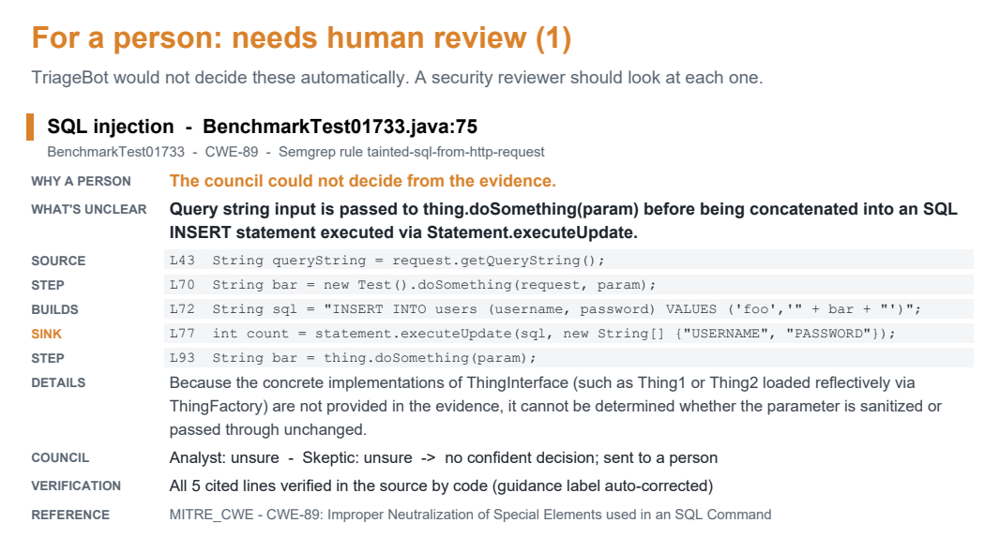</td>
</tr>
</table>

---

## 5. Where things are

```text
triagebot/       the product: one folder per pipeline stage under nodes/, the CLI, profiles, experiments
experiments/     the experiment step registry (registry.json)
data/samples/    the frozen case sets (label-free) and their fingerprints
data/semgrep/    the recorded Semgrep scan everyone scores
evidence/        every experiment run, the retrieval check and the whole-system projection
verification/    free checks: retrieval quality, whole system vs Semgrep, feasibility scripts
tests/           offline tests (no network, no API key)
docs/            design decisions, architecture diagram, proposal, feasibility reports
ai-log/          each member's AI-use log
archive/         superseded runs and documents, kept as the record
```

---

## 6. How it works

| Stage | What it does |
| --- | --- |
| **Evidence pack** | For each alert TriageBot builds what the AI sees: ±60 lines of the alert's file, the methods that code calls, the project files and scripts it references, and security guidance. The guidance is found by semantic search over the OWASP Cheat Sheet Series, anchored on the alert's MITRE CWE record, which is attached first (design decisions 28 and 29). An alert with no valid CWE goes to human review. The answer key never reaches a prompt. |
| **Council** | An Analyst and a Skeptic review the evidence in parallel, and a Chair weighs both reports and decides (`triagebot/council_graph.py`, on LangGraph). The single agent is the plain-Python baseline it is compared with. |
| **Deterministic validator** | Every verdict must cite exact file, line and quoted text from the evidence; malformed output or a citation that does not match becomes "needs a human" (`triagebot/nodes/validate/`). |
| **Durable sessions** | `council-start`, `council-status` and `council-resume` save a council run to a local SQLite file (`.triagebot/checkpoints.sqlite`, git-ignored) so it can be resumed after a crash. Resuming an unfinished run needs `--allow-replay`, because a call may be billed twice. The file holds source excerpts and model reports; do not share it. |

Settings live in `triagebot/config.py` and the experiment profiles in
`triagebot/profiles.py`. The reasoning behind each choice is in
[docs/DESIGN_DECISIONS.md](docs/DESIGN_DECISIONS.md).

Run the tests (offline; CI runs them on Windows, macOS and Linux):

```bash
python -m unittest discover -s tests
```

---

## 7. Troubleshooting

| Problem | Fix |
| --- | --- |
| The vector-store build prints nothing for minutes | Expected on the first build (it embeds the whole knowledge base). Later builds embed only what changed. |
| Loading the embedding model hangs (after the first download) | Set `HF_HUB_OFFLINE=1` (PowerShell: `$env:HF_HUB_OFFLINE = "1"`) and run again, so it uses the downloaded copy without contacting Hugging Face. |
| Ctrl+C during a run | Safe. Each case is saved as it finishes, and the next `experiment run` resumes where it stopped. |
| Output stops in a Windows terminal | Clicking in the window selects text and pauses the program. Press Esc to continue. |
| "No module named rich", or no `(.venv)` in the prompt | Activate the environment (`.\.venv\Scripts\Activate.ps1` or `source .venv/bin/activate`). |
| PowerShell: "running scripts is disabled on this system" | Run `Set-ExecutionPolicy -Scope Process RemoteSigned`, then activate again. |
| "detached HEAD" after the Benchmark checkout | Expected; it is at the pinned commit. |
| macOS: "TriageBot needs Python 3.10 or newer" | The built-in `python3` is too old. Install a newer one (python.org or `brew install python@3.12`), delete `.venv` and create it again. |
| Semgrep fails to install | Only re-scans need it; TriageBot scores the recorded scan in `data/semgrep/`. |

---

## 8. Responsible AI and safety

The risk register, mitigations, residual risks and the human-oversight rule are
in [RESPONSIBLE_AI_RISK_ASSESSMENT.md](RESPONSIBLE_AI_RISK_ASSESSMENT.md).

> [!IMPORTANT]
> TriageBot is decision support. A qualified reviewer must check the cited
> code before any finding is suppressed.

- It cannot recover what Semgrep missed, and a validated citation proves the
  quote exists, not that the reasoning is right: in step 5 all three reviewers
  dismissed one real vulnerability with a plausible but incomplete argument.
- The answer key is read only by the evaluation code, after the model calls.
- Source code, scanner output, retrieved text and model output are treated as
  untrusted data.
- Never commit API keys, `.env`, the Benchmark checkout or anything under
  `Context/` other than its README and `.gitignore`.

**AI use disclosure.** Each member keeps a log in `ai-log/<name>.md`, and
AI-assisted commits carry an `Assisted-by:` trailer. The consolidated record is
[AI_USE_DISCLOSURE.md](AI_USE_DISCLOSURE.md); see also design decision 16.

---

## 9. Team and roles

| Member | Responsibilities |
| --- | --- |
| Darren | Semgrep integration, alert normalisation, benchmark mapping and dev/test split; the scanner-baseline screen, quick start and CI. For the final version: the replayable experiment framework, experiment steps 1 to 7 and their recorded results, semantic retrieval as the default, the rebuilt mutation test, the whole-system projection, and the README and archive restructure |
| Hong Yi | Shared contracts, retrieval knowledge base, context payload, review roles and the live OpenRouter caller; the LangGraph council and its SQLite checkpoint sessions; semantic retrieval over the MITRE CWE catalogue and its vector store; the full PDF triage report; the README redesign and architecture diagram |
| Lisa | Deterministic validator; checkpoint report and AI-use records |
| Bradley | Evaluation harness and scoring tests, checkpoint report |
| Wei Lin | Repository setup and feasibility study, pipeline integration and evaluation architecture, the command-injection evidence fix and fresh 120-case evaluation, final submission materials, the ten-alert demo |

---

## 10. Third-party content

- **OWASP Cheat Sheet Series** (the guidance knowledge base): CC BY-SA 4.0; see
  [triagebot/nodes/context/kb/README.md](triagebot/nodes/context/kb/README.md).
- **MITRE CWE** (semantic retrieval quotes a weakness's description and
  mitigations, and searches with its name and alternate terms): © The MITRE
  Corporation, used under the CWE Terms of Use reproduced in
  [triagebot/nodes/context/MITRE_CWE_NOTICE.md](triagebot/nodes/context/MITRE_CWE_NOTICE.md).

<p align="center"><sub>Results come from the synthetic OWASP Benchmark (Java); they are not a guarantee of performance on real projects.</sub></p>
