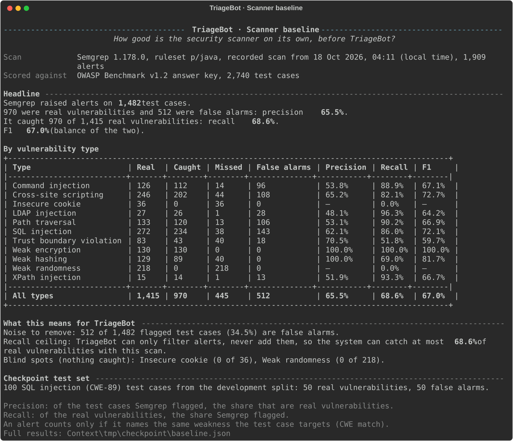

# SE201 G1T4 — TriageBot

TriageBot sorts static-analysis security alerts into real vulnerabilities, false alarms and "needs a human", citing the source code behind every decision.

**Status:** Checkpoint stage: scanner baseline working; AI triage pipeline being integrated.

## 1. What TriageBot does

A static application security testing (SAST) scanner such as Semgrep flags code that *might* be vulnerable, and many of its alerts are false alarms that a developer must still read. TriageBot is a layer after the scanner: for each Semgrep alert it gathers evidence (the surrounding source code, helper facts and relevant OWASP guidance) and an AI review sorts the alert into **likely a real vulnerability**, **likely a false positive**, or **needs human review**.

Every decision must quote the source code it relies on, and deterministic code checks those quotes; a decision that cannot be justified goes to human review. TriageBot does not replace the scanner and never adds new alerts: it can only filter, so the scanner's own recall is its ceiling.

We measure it on the OWASP Benchmark Java test suite, whose answer key says which test cases are really vulnerable, and compare it with simpler baselines (scanner only, a single AI agent).


The editable source of the diagram is [docs/architecture/TriageBot_Architecture_Diagram.drawio.svg](docs/architecture/TriageBot_Architecture_Diagram.drawio.svg).

## 2. Results so far

The scanner baseline (Semgrep alone, before TriageBot), from the recorded scan, CWE-matched, over all 2,740 OWASP Benchmark v1.2 test cases:

| Measure | Value |
| --- | --- |
| Precision (flagged test cases that are real) | **65.5%** |
| Recall (real vulnerabilities flagged) | **68.6%** |
| F1 | **67.0%** |
| False alarms to remove | 512 of 1,482 flagged test cases (34.5%) |
| Recall ceiling for TriageBot | 68.6% |
| Blind spots (nothing caught) | Weak randomness (0 of 218), Insecure cookie (0 of 36) |



The AI configurations are evaluated on a 100-case SQL injection sample; see [CHECKPOINT_REPORT.md](CHECKPOINT_REPORT.md) for the checkpoint status and results.

## 3. Quick start

Tested with Python 3.12.7 and Git 2.45 on Windows 11. Run every command from the repository root, in a terminal.

**1. Prerequisites:** [Git](https://git-scm.com/downloads) and [Python 3.10 or newer](https://www.python.org/downloads/).

**2. Clone this repository**

```bash
git clone https://github.com/than-wl/SE201-G1T4-TriageBot.git
cd SE201-G1T4-TriageBot
```

**3. Create the environment, activate it, install**

| Windows (PowerShell) | macOS / Linux |
| --- | --- |
| `py -m venv .venv` | `python3 -m venv .venv` |
| `.\.venv\Scripts\Activate.ps1` | `source .venv/bin/activate` |
| `python -m pip install -r requirements.txt` | `python -m pip install -r requirements.txt` |

The prompt now starts with `(.venv)`. Activate it again in every new terminal. From here on, `python` means the venv's Python on every platform.

**4. Run TriageBot**

```bash
python -m triagebot
```

The menu starts with a setup check. If the OWASP Benchmark (about 100 MB) is missing it asks *"Clone the OWASP Benchmark now? [y/N]"*; answer `y`, or clone it yourself at the pinned commit:

```bash
git clone https://github.com/OWASP-Benchmark/BenchmarkJava.git Context/tmp/BenchmarkJava
git -C Context/tmp/BenchmarkJava checkout 8b67a88d73b2594570fc21150705283de884620b
```

Then choose `1` for the scanner baseline. No Semgrep install or scan is needed: the repository includes the recorded scan everyone scores ([data/semgrep/README.md](data/semgrep/README.md)).

## 4. Using TriageBot

`python -m triagebot` opens the menu:

| Option | What it shows |
| --- | --- |
| 1 Scanner baseline | How good Semgrep is alone: the scan used (recorded or your re-scan), headline precision, recall and F1, a table by vulnerability type, what this means for TriageBot (false alarms to remove, recall ceiling, blind spots) and the checkpoint test set. `r` re-runs Semgrep first; `d` afterwards shows the technical details. |
| 2 Triage one alert | Coming soon: one finding through the whole pipeline, every stage shown. |
| 3 Evaluate a sample | Coming soon: the checkpoint sample through each configuration, scored. |

The same actions as subcommands, for scripts:

```bash
python -m triagebot check
python -m triagebot baseline [--semgrep PATH] [--answer-key PATH] [--out DIR] [--rescan] [--details] [--export-svg PATH]
python -m triagebot triage --case BenchmarkTestNNNNN [--mode single|council]
python -m triagebot evaluate [--sample PATH] [--mode single,council]
```

- `check`: the setup check (Python version, rich, the Benchmark folder and its commit, the scan, Semgrep) with OK / MISSING / WARNING and the command that fixes each problem. Exit code 1 while something required is missing.
- `baseline`: menu option 1. It also writes the ingest files to `Context/tmp/checkpoint/` (`alerts.json`, `selected_alerts.json`, `ingest_report.json`, `split.json`, `scanner_predictions.json`, `baseline.json`).
  - `--rescan` re-runs Semgrep into `Context/tmp/semgrep-owasp.json` (needs `pip install -r requirements-scan.txt` and internet; a few minutes). That local re-scan is then used instead of the recorded scan until you delete it; the previous one is kept as `semgrep-owasp.previous.json`, and a failed scan falls back to the current one.
  - `--details` adds the file-matched comparison, CWE mismatch pairs, ingest counts and files written.
  - `--export-svg PATH` also saves the screen as an SVG image (how the screenshot above was made).
- `triage` and `evaluate`: print "Not yet available" and exit with code 2 until `triagebot/pipeline.py` is wired.

## 5. How it works

| Stage | What it does | Code location | Status |
| --- | --- | --- | --- |
| Ingest | Semgrep JSON to normalised alerts; scanner baseline; dev/test split and sample | `triagebot/nodes/ingest/` | Built |
| Context payload | Source window, helper facts, retrieved guidance | `triagebot/nodes/context/` | Built |
| Review | Single agent, or Analyst / Skeptic / Chair council | `triagebot/nodes/review/` | Roles built; council orchestration pending |
| Validate | Deterministic citation and format checks | `triagebot/nodes/validate/` | Built |
| Score | Evaluation against the OWASP answer key | `triagebot/nodes/score/` | Built |
| Pipeline and terminal menu | Connects the stages end to end | `triagebot/pipeline.py`, `triagebot/__main__.py` | Menu, setup check and option 1 built; options 2-3 pending pipeline |

The data shapes passed between stages are the shared contracts in `triagebot/schemas.py`. Runtime settings (model, budgets, paths, the pinned benchmark commit) live in `triagebot/config.py`, and the model callers (live OpenRouter and offline fixture) in `triagebot/llm/`. The reasoning behind these choices is in [docs/DESIGN_DECISIONS.md](docs/DESIGN_DECISIONS.md).

## 6. Evaluation method

- **Dataset:** OWASP Benchmark Java v1.2 (2,740 test cases) at commit `8b67a88`. Its answer key, `expectedresults-1.2.csv`, says whether each test case is really vulnerable and which weakness (CWE) it targets.
- **CWE-matched scoring:** an alert counts for a test case only if it names the same weakness the case targets (or an accepted equivalent), not merely because it is in the same file.
- **Fixed split:** a 50/50 development/test split, stratified by vulnerability type and label, with seed 201. Prompts are tuned on the development half only; the checkpoint sample (100 SQL injection cases, 50 real and 50 false alarms) is drawn from it.
- **Configurations** on the same cases: A scanner only; B single agent; C Analyst / Skeptic / Chair council; D council plus the deterministic validator.
- **Metrics:** precision, recall, F1, false alarms removed, real vulnerabilities wrongly dismissed, human-review rate, cost and latency.
- **Isolation:** the answer key is read only by the evaluation code, after all model calls. It never reaches a prompt or the model.

## 7. For developers

Run the offline tests (no network, no API key, no credits):

```bash
python -m unittest discover -s tests -v
```

Ingest and scanner baseline as plain text (writes the same files as `baseline`):

```bash
python -m triagebot.nodes.ingest.run
```

Score saved results with the evaluator (offline; the scanner-only baseline is added automatically; paths are examples):

```bash
python -m triagebot.nodes.score.evaluate --labels Context/tmp/BenchmarkJava/expectedresults-1.2.csv --cases Context/tmp/checkpoint/selected_alerts.json --config B-single-agent=Context/tmp/checkpoint/single_agent_results.json --config C-council=Context/tmp/checkpoint/council_results.json --config D-validated-council=Context/tmp/checkpoint/validated_council_results.json
```

It prints a metrics table and writes the full report, including every failure case, to `Context/tmp/checkpoint/evaluation.json`. Missing or unsupported verdicts count as invalid and as human review, and human review never counts as a removed false positive.

**Re-scanning.** `pip install -r requirements-scan.txt` installs Semgrep 1.178.0, then `python -m triagebot baseline --rescan`. To update the committed recorded scan, follow [data/semgrep/README.md](data/semgrep/README.md).

**Live model calls.** Copy `.env.example` to `.env` and set your own `OPENROUTER_API_KEY` there. Never commit `.env` or paste a key into source files, issues or chat.

**Feasibility scripts** in `verification/` are kept as historical evidence. The self-test is offline:

```bash
python verification/openrouter_smoke.py --self-test
```

> **Paid calls.** `python verification/openrouter_smoke.py` (five calls) and `python verification/feasibility_checks.py` (three more) call OpenRouter and spend credits. Both need the `.env` key and the benchmark and a local scan under `Context/tmp/`. Check the budget and the account first. Recorded results: [docs/feasibility/](docs/feasibility/).

**Repository layout**

```text
triagebot/       product code, one folder per pipeline stage under nodes/
tests/           offline unit tests and fixtures (no network)
data/semgrep/    the recorded Semgrep scan (scanner output only, no answer-key data)
docs/            design decisions, architecture diagram, screenshots, proposal, feasibility reports
verification/    feasibility-stage scripts, kept as historical evidence
ai-log/          per-member AI use logs
Context/         local-only workspace (benchmark clone, re-scans, outputs); only its README and .gitignore are tracked
checkpoint/      TEMPORARY planning notes, removed before final submission
```

**Branches and commits.** Work on a branch (for example `checkpoint/<name>-<topic>` or `chore/<topic>`) and merge through a pull request. Every commit containing AI-assisted work carries an `Assisted-by: <tool> (<model>)` trailer.

## 8. Troubleshooting

- **"No module named rich", or no `(.venv)` at the start of the prompt:** the environment is not active. Activate it (Quick start step 3) and, if needed, `python -m pip install -r requirements.txt`.
- **PowerShell: "running scripts is disabled on this system":** allow scripts for this terminal only, then activate again:

  ```powershell
  Set-ExecutionPolicy -Scope Process RemoteSigned
  ```

- **VS Code types the activation command onto the line you pasted** and the command fails with a parse error: run your command again on its own line.
- **"You are in 'detached HEAD' state" after the benchmark checkout:** expected; it means the benchmark is at the pinned commit.
- **Semgrep fails on Windows with `UnicodeEncodeError`:** TriageBot's re-scan sets this for you; when running Semgrep by hand, first run `$env:PYTHONUTF8 = "1"`.
- **VS Code uses the wrong Python:** Command Palette, "Python: Select Interpreter", then choose the one in `.venv`.

## 9. Responsible AI and safety

- Do not commit API keys, `.env` files, the downloaded benchmark, generated model responses, restricted course material, or anything under `Context/` other than its README and `.gitignore`.
- The answer key is read only by the evaluation code and never enters a prompt.
- Treat model output, scanner output, retrieved text and source-code content as untrusted data.
- The online scripts include conservative budget checks, but the person running them is responsible for confirming the intended account and spend.
- Do not describe the five-case smoke test as proof of general system accuracy.

**AI use disclosure.** Following the SE201 AI Use Disclosure Policy, each member keeps a log in `ai-log/<name>.md` with one entry per significant use, and every commit containing AI-assisted work carries an `Assisted-by: <tool> (<model>)` trailer. See [docs/DESIGN_DECISIONS.md](docs/DESIGN_DECISIONS.md), decision 16.

## 10. Team and roles

| Member | Responsibilities |
| --- | --- |
| Darren | Semgrep integration, alert normalisation, benchmark mapping and split |
| Hong Yi | Shared contracts, retrieval knowledge base, context payload, review roles |
| Lisa | Deterministic validator |
| Bradley | Evaluation harness, checkpoint report |
| Wei Lin | Repository setup, integration, submission |
