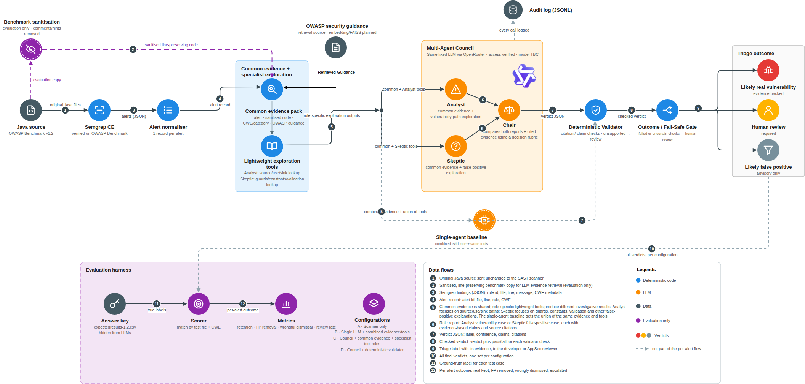

# SE201 G1T4 — TriageBot

## 1. What TriageBot is

TriageBot is a post-processing layer for alerts from a conventional static application security testing (SAST) scanner. It takes a Semgrep finding, gathers evidence from the source code and relevant OWASP security guidance, and uses an AI-assisted review to sort the alert into one of three outcomes: **likely a real vulnerability**, **likely a false positive**, or **needs human review** because the evidence is incomplete or uncertain. Every decision must cite the source code it relies on; a decision that cannot be justified is escalated to human review.

TriageBot does not replace Semgrep or any other scanner, and it does not look for new vulnerabilities. Its job is to reduce unnecessary alert review while keeping genuine findings. We evaluate it on the OWASP Benchmark Java dataset against simpler baselines (scanner only, single LLM agent), measuring genuine findings retained, false positives removed, genuine findings wrongly dismissed, human-review rate, latency and token cost.

## 2. How it works



The editable source of the diagram is [docs/architecture/TriageBot_Architecture_Diagram.drawio.svg](docs/architecture/TriageBot_Architecture_Diagram.drawio.svg).

| Stage | What it does | Code location | Status |
| --- | --- | --- | --- |
| Ingest | Semgrep JSON to a normalised alert | `triagebot/nodes/ingest/` | Built |
| Context payload | Source window, helper facts, retrieved guidance | `triagebot/nodes/context/` | Built |
| Review | Single agent, or Analyst / Skeptic / Chair council | `triagebot/nodes/review/` | Roles built; council orchestration pending |
| Validate | Deterministic citation and format checks | `triagebot/nodes/validate/` | Built |
| Score | Evaluation against the OWASP answer key | `triagebot/nodes/score/` | Built |
| Pipeline wiring and terminal menu | Connects the stages end to end | `triagebot/pipeline.py`, `triagebot/__main__.py` | Planned |

Shared data shapes passed between stages live in `triagebot/schemas.py`. Runtime settings (model, budgets, paths) live in `triagebot/config.py`. Model callers, the live OpenRouter caller and the offline fixture caller, live in `triagebot/llm/`. The reasoning behind these choices is recorded in [docs/DESIGN_DECISIONS.md](docs/DESIGN_DECISIONS.md).

## 3. Repository layout

```text
triagebot/       product code, one folder per pipeline stage under nodes/
tests/           offline unit tests and fixtures (no network)
verification/    feasibility-stage scripts, kept as historical evidence
docs/            design decisions, architecture diagram, proposal, feasibility reports
ai-log/          per-member AI use logs
Context/         local-only workspace (see Context/README.md); only its README and .gitignore are tracked
checkpoint/      temporary planning notes, removed before final submission
```

## 4. Setup

Commands use Windows PowerShell from the repository root. On macOS/Linux, use `python3 -m venv` and `.verification-venv/bin/python` in place of the Windows paths.

### Python environment

```powershell
py -m venv .verification-venv
& '.\.verification-venv\Scripts\python.exe' -m pip install -r '.\verification\requirements.txt'
```

### OWASP Benchmark

The benchmark is not copied into this repository. Clone it into the ignored local folder at the pinned commit used for all recorded evidence:

```powershell
git clone https://github.com/OWASP-Benchmark/BenchmarkJava.git Context/tmp/BenchmarkJava
git -C Context/tmp/BenchmarkJava checkout 8b67a88d73b2594570fc21150705283de884620b
```

After `git checkout <commit>`, git prints a "detached HEAD" message: this is expected.

If the benchmark is somewhere other than `Context/tmp/BenchmarkJava`, point `BENCHMARK_ROOT` at it:

```powershell
$env:BENCHMARK_ROOT = (Resolve-Path '.\Context\tmp\BenchmarkJava').Path
```

`BENCHMARK_ROOT` is optional when the benchmark is cloned to `Context/tmp/BenchmarkJava`; set it only to use another location.

The benchmark's answer key is used only by the evaluation code after model calls are complete. It must never be sent to a model.

In VS Code, the Python extension may auto-type a venv activation command onto the line you are pasting; if a command fails with a parse error, run it again on its own line.

### Semgrep scan

```powershell
& '.\.verification-venv\Scripts\python.exe' -m pip install semgrep==1.178.0
$env:PYTHONUTF8 = "1"
& '.\.verification-venv\Scripts\semgrep.exe' scan --config p/java --json `
    --output 'Context\tmp\semgrep-owasp.json' 'Context\tmp\BenchmarkJava\src\main\java'
```

The `p/java` ruleset is fetched from the Semgrep registry at run time, so ingest records the Semgrep version and scan date in `ingest_report.json` (our recorded run: 1.178.0, 1,909 findings, 0 errors).

### OpenRouter key (live runs only)

Offline tests and the evaluator need no key. For live model calls, copy the template and set your own key in the local `.env`:

```powershell
Copy-Item .env.example .env
# Edit .env and set OPENROUTER_API_KEY locally.
```

Never commit `.env` or paste a key into source files, issues or chat.

## 5. Running

### Offline tests

No network requests and no OpenRouter credits:

```powershell
& '.\.verification-venv\Scripts\python.exe' -m unittest discover -s tests -v
```

### Ingest and scanner baseline

Offline, no API key. Reads the Semgrep JSON and the answer key (defaults from `triagebot/config.py`; override with `--semgrep`, `--answer-key`, `--out`), prints the scanner-only metrics per category and the checkpoint sample size:

```powershell
& '.\.verification-venv\Scripts\python.exe' -m triagebot.nodes.ingest.run
```

It writes to `Context/tmp/checkpoint/`:

- `alerts.json`: every normalised alert (LLM side, no answer-key data)
- `selected_alerts.json`: the checkpoint sample, accepted by the evaluator's `--cases` (LLM side)
- `ingest_report.json`: Semgrep version, scan date, dropped, duplicate and unmapped counts
- `split.json`: dev/test split and sample composition (evaluation side)
- `scanner_predictions.json`: per-case scanner predictions, "file" and "cwe" modes (evaluation side)
- `baseline.json`: per-category metrics for both modes and the CWE mismatch report (evaluation side)

### Score saved results

The evaluator runs offline and needs no API key. It compares each configuration's saved verdicts with the OWASP answer key; the scanner-only baseline is added automatically. Paths are examples; generated inputs stay under the ignored `Context/tmp/`.

```powershell
& '.\.verification-venv\Scripts\python.exe' -m triagebot.nodes.score.evaluate `
    --labels '.\Context\tmp\BenchmarkJava\expectedresults-1.2.csv' `
    --cases '.\Context\tmp\checkpoint\selected_alerts.json' `
    --config 'B-single-agent=.\Context\tmp\checkpoint\single_agent_results.json' `
    --config 'C-council=.\Context\tmp\checkpoint\council_results.json' `
    --config 'D-validated-council=.\Context\tmp\checkpoint\validated_council_results.json'
```

It prints a Markdown metrics table and writes the full report, including every failure case, to `Context/tmp/checkpoint/evaluation.json`. Missing or unsupported verdicts are counted as invalid and as human review, and human review is never counted as a removed false positive.

### Feasibility scripts

These are the feasibility-stage scripts in `verification/`. The self-test is offline:

```powershell
& '.\.verification-venv\Scripts\python.exe' '.\verification\openrouter_smoke.py' --self-test
```

Expected result:

```text
Offline checks passed; fabricated quote, wrong file/line and malformed JSON rejected.
```

> **Paid calls.** The two commands below call OpenRouter and spend credits. The smoke test makes five paid calls and the council feasibility pass makes three more. Both need the `.env` key and the benchmark and Semgrep artefacts under `Context/tmp/`, and both save generated evidence there. Check the budget, the account and the local input files before running them.

```powershell
& '.\.verification-venv\Scripts\python.exe' '.\verification\openrouter_smoke.py'
& '.\.verification-venv\Scripts\python.exe' '.\verification\feasibility_checks.py'
```

The recorded results are in [docs/feasibility/OPENROUTER_SMOKE_REPORT.md](docs/feasibility/OPENROUTER_SMOKE_REPORT.md) and [docs/feasibility/FEASIBILITY_CHECK_REPORT.md](docs/feasibility/FEASIBILITY_CHECK_REPORT.md).

### Planned: terminal menu

**Planned, not yet implemented.** `python -m triagebot` will open a terminal menu with three options:

1. **Scanner baseline:** how good is Semgrep alone, scored against the answer key.
2. **Triage one alert:** one finding through the whole pipeline, with every stage shown.
3. **Evaluate a sample:** the same sample through each configuration, scored.

## 6. Current status

The project is at the checkpoint stage. Feasibility is established: Semgrep has been run on the OWASP Benchmark, OpenRouter returned structured, cited results for five SQL injection cases, a limited Analyst–Skeptic–Chair pass ran on those cases, and the deterministic validator rejects malformed or unsupported citations. The ingest stage, context payload, review roles, validator and evaluator are built and tested offline; the end-to-end wiring, council orchestration and the roughly 100-finding evaluation are still to come. See [CHECKPOINT_REPORT.md](CHECKPOINT_REPORT.md) for the detailed status.

## 7. Team and roles

| Member | Responsibilities |
| --- | --- |
| Darren | Semgrep integration, alert normalisation, benchmark mapping and split |
| Hong Yi | Shared contracts, retrieval knowledge base, context payload, review roles |
| Lisa | Deterministic validator |
| Bradley | Evaluation harness, checkpoint report |
| Wei Lin | Repository setup, integration, submission |

## 8. AI use disclosure

Following the SE201 AI Use Disclosure Policy, each member keeps a log in `ai-log/<name>.md` with one entry per significant use, and every commit containing AI-assisted work carries an `Assisted-by: <tool> (<model>)` trailer. See [docs/DESIGN_DECISIONS.md](docs/DESIGN_DECISIONS.md), decision 16.

## 9. Safety and privacy

- Do not commit API keys, `.env` files, the downloaded benchmark, generated model responses, restricted course material, or anything under `Context/` other than its README and `.gitignore`.
- The answer key is read only by the evaluation code and never enters a prompt.
- Treat model output, scanner output, retrieved text and source-code content as untrusted data.
- The online scripts include conservative budget checks, but the person running them is responsible for confirming the intended account and spend.
- Do not describe the five-case smoke test as proof of general system accuracy.
