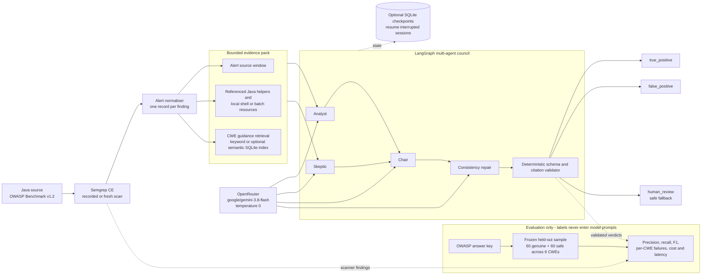

# TriageBot architecture

The editable Mermaid source used for exported images is
[`TriageBot_Architecture_Diagram.mmd`](TriageBot_Architecture_Diagram.mmd).

The answer key is isolated inside the evaluation harness. Runtime reviewers see
only the Semgrep alert, bounded project evidence, and retrieved security
guidance. A validated citation proves that quoted text exists; it does not prove
that the model's security interpretation is correct.
